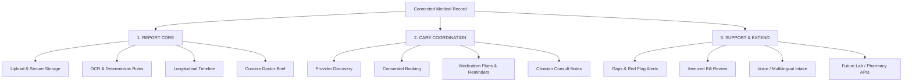
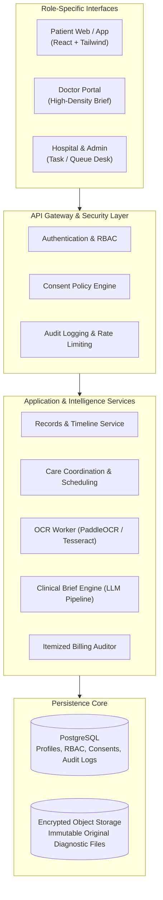

# MediConnect AI (MediAI Exchange)
### Evidence-Linked Records • Clinician-Led Care • Intelligent Health Coordination

> **Event**: AAYU 2026 Hackathon  
> **Problem Statement ID**: `[Confirm: T01]` — *AI-assisted medical reports and patient care*  
> **Team ID**: `[Confirm: AAYU-WF9D]`  
> **Registered Team**: `[Confirm: S Square]`  
> **Theme / Category**: Healthcare / MedTech (Proposed) • Software  
> **Repository**: [https://github.com/sunil-kumawat-54/Medi-Connect-AI-----AAYU-hackathon-2026](https://github.com/sunil-kumawat-54/Medi-Connect-AI-----AAYU-hackathon-2026)  
> **Status**: Concept & Prototype Baseline (Research cut-off: 13 October 2026)

---

## Table of Contents
1. [Executive Summary & Core Differentiators](#1-executive-summary--core-differentiators)
2. [Complete Pitch Deck (Slide-by-Slide Presentation)](#2-complete-pitch-deck-slide-by-slide-presentation)
   - [Slide 01: Title & Overview](#slide-01-title--overview)
   - [Slide 02: Problem Statement & Root Cause Tree](#slide-02-problem-statement--root-cause-tree)
   - [Slide 03: Proposed Solution & Feature Hierarchy](#slide-03-proposed-solution--feature-hierarchy)
   - [Slide 04: Nine-Stage End-to-End Workflow](#slide-04-nine-stage-end-to-end-workflow)
   - [Slide 05: Technical Approach & Auditable AI Pipeline](#slide-05-technical-approach--auditable-ai-pipeline)
   - [Slide 06: System Architecture & Proposed Stack](#slide-06-system-architecture--proposed-stack)
   - [Slide 07: User Roles & Four Workspaces](#slide-07-user-roles--four-workspaces)
   - [Slide 08: Dated Medical History & Trend Drill-Down](#slide-08-dated-medical-history--trend-drill-down)
   - [Slide 09: Feasibility, Viability & Risk Mitigations](#slide-09-feasibility-viability--risk-mitigations)
   - [Slide 10: Impact, Benefits & Evaluation Framework](#slide-10-impact-benefits--evaluation-framework)
   - [Slide 11: Research, Ecosystem Positioning & Standards](#slide-11-research-ecosystem-positioning--standards)
   - [Slide 12: Final Summary & Repository Access](#slide-12-final-summary--repository-access)
3. [Evidence, Design Boundaries & Validation Companion Report](#3-evidence-design-boundaries--validation-companion-report)
   - [Report Section 1: What the Uploads Actually Establish](#report-section-1-what-the-uploads-actually-establish)
   - [Report Section 2: Confirmation Items Before Formal Submission](#report-section-2-confirmation-items-before-formal-submission)
   - [Report Section 3: Scope & Implementation Status Matrix](#report-section-3-scope--implementation-status-matrix)
   - [Report Section 4: Traceability as a First-Class Data Contract](#report-section-4-traceability-as-a-first-class-data-contract)
   - [Report Section 5: Error Handling & Clinical Boundaries](#report-section-5-error-handling--clinical-boundaries)
   - [Report Section 6: Access and Retention Separation](#report-section-6-access-and-retention-separation)
   - [Report Section 7: Future Interoperability Assessment (FHIR & ABDM)](#report-section-7-future-interoperability-assessment-fhir--abdm)
   - [Report Section 8: India Legal Status: DPDP Act & Regulations](#report-section-8-india-legal-status-dpdp-act--regulations)
   - [Report Section 9: Proposed Evaluation Design & Validation Protocol](#report-section-9-proposed-evaluation-design--validation-protocol)
   - [Report Section 10: India & Global Ecosystem Positioning](#report-section-10-india--global-ecosystem-positioning)
   - [Report Section 11: Official References & Evidence Limits](#report-section-11-official-references--evidence-limits)
4. [Monorepo Architecture & Local Setup](#4-monorepo-architecture--local-setup)

---

## 1. Executive Summary & Core Differentiators

**MediConnect AI** (also identified as *MediAI Exchange*) is a clinical intelligence and patient coordination platform designed to bridge the severe fragmentation of diagnostic documents across disparate clinics, laboratories, and physical paper files.

Rather than relying on ungrounded generative AI summaries that risk medical hallucinations, MediConnect AI operates under strict clinical and algorithmic rules:

| Core Pillar | Engineering & Clinical Guarantee | What We Strictly DO NOT Do |
| :--- | :--- | :--- |
| **Source-Linked Grounding** | Every biomarker value, clinical trend, and brief sentence is explicitly tied to its source document ID, page, and bounding coordinate. | Never present opaque LLM summaries without direct interactive visual proof to the source scan. |
| **Rules-Before-Reasoning** | Range classifications (Normal, Elevated, Critical) are deterministic code rules (`evaluator.ts`) tested against laboratory reference ranges. | Never allow an LLM to probabilistically invent or guess numeric abnormality ranges. |
| **Doctor-in-Control** | Clinicians hold sole authority to **[Approve]**, **[Edit / Correct]**, or **[Reject]** AI draft briefs before incorporation into care plans. | Never allow autonomous AI prescriptions, auto-diagnoses, or unilateral modification of legal medical records. |
| **Gaps & Contradiction Detection** | Rule algorithms identify missing longitudinal monitoring (e.g. Diabetics missing Creatinine for >12 months) and conflicting readings. | Never evaluate single lab sheets in isolation without historic contextual cross-examination. |
| **Itemized Billing Review** | Arithmetic sum verification and duplicate line-item audits flag entries for human billing review. | Never output accusatory "fraud" claims; all flags are categorized as *"Possible Discrepancy Flagged for Review"*. |

---

## 2. Complete Pitch Deck (Slide-by-Slide Presentation)

*The following twelve sections represent the complete slide deck from `MediConnect_AI_AAYU_2026 (1).pptx`, capturing every slide's structured layout, visual architecture, content hierarchy, and presenter notes.*

```
+----------------------------------------------------------------------------------------------------+
|                                           DECK NAVIGATION                                          |
| [HOME: 01]  [IDEA: 02-03]  [WORKFLOW: 04]  [ARCHITECTURE: 05-06]  [RISKS: 09]  [IMPACT: 10] [CLOSE: 12] |
+----------------------------------------------------------------------------------------------------+
```

---

### Slide 01: Title & Overview
**Category**: `AAYU 2026 / TITLE` • **Deck Slide**: `01 / 12`  
**Headline**: *Evidence-linked records. Clinician-led care.*  
**Tagline**: *Organize medical reports into a longitudinal history and a concise, source-linked doctor brief.*

#### Event & Metadata Confirmation
* **Event**: AAYU 2026
* **PS ID**: `[Confirm: T01]`
* **Team ID**: `[Confirm: AAYU-WF9D]`
* **Registered Team**: `[Confirm: S Square]`
* **Theme / Category**: Healthcare / MedTech (proposed) • Software
* **PS Title**: `[Confirm official title]` AI-assisted reports & patient care
* **Status**: `CONCEPT • NOT VALIDATED`

#### Conceptual Architecture Diagram
```
   [PATIENT] <==================> [CONSENT LAYER] <==================> [DOCTOR]
      |                                                                    |
      v                                                                    v
[ORIGINAL REPORTS]  -------->  [SOURCE-LINKED AI]  -------->  [CLINICIAN REVIEW]
(PDF / Scans / Camera)       (OCR + Extraction + Audit)       (Approve / Edit / Reject)
```

> **Presenter Notes (Slide 1)**:  
> *Opening*: MediConnect AI helps clinicians find the relevant evidence while patients retain a durable record. Lead with the report-to-brief concept rather than a broad claim that AI delivers better healthcare. AAYU 2026 is supported by the uploaded official template. `T01`, `AAYU-WF9D` and `S Square` appear in the uploaded project deck, but notes call identifiers placeholders; confirmation is required. No official problem-statement document was uploaded. The twelve slides expand the seven template sections and preserve event/organizer branding; this is not a claim of verified submission-format compliance.  
> *Status*: No implemented feature or clinical result is established by the uploaded materials. Original documents are preserved. AI does not independently diagnose or prescribe.

---

### Slide 02: Problem Statement & Root Cause Tree
**Category**: `AAYU 2026 / PROBLEM STATEMENT` • **Deck Slide**: `02 / 12`  
**Headline**: *The missing link is usable clinical context*  
**Scope**: *Qualitative problem framing from project notes — not prevalence statistics or measured workflow findings.*

#### Root Causes
1. **Scattered Information**: Reports fragmented across past visits, clinics, diagnostic labs, paper files, and disparate mobile devices.
2. **Unstructured Documents**: Physical paper wrinkles, unstandardized abbreviations, conflicting dates, different biomarker units ($\text{mg/dL}$ vs $\text{mmol/L}$).
3. **Disconnected Workflows**: Records, hospital scheduling, and follow-up care instructions operate in complete administrative silos.

#### Stakeholder Impact Matrix
```
   [PATIENTS]                [DOCTORS]                  [HOSPITALS]
+----------------------+  +----------------------+   +----------------------+
| - Lost paper reports |  | - Rush: 3-5 min OPD  |   | - Scheduling friction|
| - Unclear lab terms  |  | - Time spent hunting |   | - Manual handoffs    |
| - Missed follow-ups  |  | - Incomplete context |   | - Billing disputes   |
| - Repeated bloodwork |  | - Harder comparisons |   | - Uncoordinated care |
+----------------------+  +----------------------+   +----------------------+
```
* **Supporting Need**: Confusing or duplicate bill line items warrant structured clarification — not an automated fraud verdict.

> **Presenter Notes (Slide 2)**:  
> Explain the problem tree from causes to consequences. The central failure is fragmented clinical context, not a claim that no health-record platforms exist. Problems are based on supplied notes and screenshots, not quantified research. Distinguish record-review burden from diagnosis. Bill checking is a proposed supporting feature and should flag questions for billing staff, not characterize a charge as fraudulent.

---

### Slide 3: Proposed Solution & Feature Hierarchy
**Category**: `AAYU 2026 / PROPOSED SOLUTION` • **Deck Slide**: `03 / 12`  
**Headline**: *From scattered reports to a review-ready history*  
**Design Principle**: *The report-to-brief loop is the core; coordination features support it rather than compete with it.*

#### Before vs. Proposed After
* **BEFORE**: Find $\rightarrow$ Read $\rightarrow$ Reconcile $\rightarrow$ Separate reports $\rightarrow$ Repeated manual comparisons $\rightarrow$ Follow-up instructions scattered across slips.
* **PROPOSED AFTER**: `MediConnect AI` provides **Originals + Dated History + Source-Linked Doctor Brief** across Patient, Doctor, and Hospital portals.

#### Distinct Differentiators & Boundaries
* **Distinct Quality**: Evidence beside every summary sentence; uncertainty visibly surfaced; clinicians approve, correct, or reject. (Not a claim of market exclusivity).
* **MVP Boundary**: Login + Consent $\rightarrow$ Upload $\rightarrow$ Extraction $\rightarrow$ Dated Timeline $\rightarrow$ Doctor Review $\rightarrow$ Appointment / Follow-up.
* **Later Scope**: Vernacular voice intake; lab/pharmacy APIs; bill duplicates, arithmetic and tariff-based charge queries.

#### Three-Tier Feature Hierarchy


> **Presenter Notes (Slide 3)**:  
> Prioritizes summarization of existing reports without changing originals. Reconcile MediConnect AI and MediAI Exchange as one project. Discuss innovations as the proposed combination of source grounding, medical history and clinician oversight, not as a patented capability. Nearby discovery needs a provider directory and location permission.

---

### Slide 04: Nine-Stage End-to-End Workflow
**Category**: `AAYU 2026 / END-TO-END WORKFLOW` • **Deck Slide**: `04 / 12`  
**Headline**: *Nine stages. One accountable clinical loop.*  
**Design**: *Registration to follow-up, with consent, extraction recovery, and clinician review built into every handoff.*

```
 [01: Register & Consent] --------> [02: Upload History] --------> [03: Extract Evidence]
 (Scope, Recipient, Expiry)         (PDF / Scans / Rx slips)        (File checks, direct text/OCR)
             |                                                                   |
             v                                                                   v
 [06: Coordinate Care]   <--------  [05: Draft Brief]   <--------  [04: Build History]
 (Book visit, schedule access)      (Grounded citations, gaps)     (Normalize dates & units)
             |
             v
 [07: Doctor Verifies]   -------->  [08: Update Care Record] ----> [09: Timeline & Reminders]
 (Originals vs Brief: Approve)      (Clinician notes & Rx plan)    (Patient alerts & schedules)
             |
             +--------------------> [RECOVERY / HOLD QUEUE]
                                    - Low OCR confidence -> Hold for correction
                                    - Missing consent -> Block access
                                    - Unverified summary -> Excluded from permanent record
```

> **Presenter Notes (Slide 4)**:  
> Consent precedes sharing; appointment scheduling does not itself grant record access. A draft brief is not a diagnosis. The clinician verifies original evidence and authors clinical notes and prescriptions. Extraction errors enter a holding/correction queue rather than being silently guessed. Newly uploaded records re-enter processing and produce a new version. The 60-second brief is a design aspiration, not a guaranteed runtime.

---

### Slide 05: Technical Approach & Auditable AI Pipeline
**Category**: `AAYU 2026 / TECHNICAL APPROACH` • **Deck Slide**: `05 / 12`  
**Headline**: *An auditable AI pipeline — not a black-box diagnosis*  
**Principle**: *Extracted data, summaries, and original files are distinct, linked, and versioned.*

#### Ingest & Normalize Pipeline (Stages 01–04)
* **01. Validate Upload**: File extension, MIME type, size bounds, malware validation, identity metadata.
* **02. Read Document**: Digital PDF text extraction first; computer vision OCR for scans; bounding box coordinates.
* **03. Organize Fields**: Biomarker names, values, units, reference intervals, collection dates, document types.
* **04. Normalize Safely**: Resolve date formats (DD/MM/YYYY vs MM/DD/YYYY); unit compatibility; leave ambiguous tokens unresolved.

#### Check, Ground & Review Pipeline (Stages 05–08)
* **05. Secure Record Links**: Encrypted original files + relational database rows + permission-filtered access tokens.
* **06. Check Inconsistencies**: Algorithmic rules flag conflicting dates/values, missing routine monitoring, or low OCR certainty.
* **07. Draft Brief**: Prompt template restricted strictly to extracted tokens; every sentence must carry source coordinates `[DocID, Page, Box]`.
* **08. Review & Version**: Authorized clinician examines original scan beside draft; executes **Accept**, **Edit**, or **Reject**.

```
[SOURCE-GROUNDED OUTPUT CONTRACT]
Finding -> Biomarker Value + Unit -> Document ID / Page Box -> Confidence Score -> Review Status

[UNCERTAINTY GATE]
Illegible or ambiguous text is marked "UNRESOLVED". System halts automated inference.

[CRITICAL PROHIBITIONS]
[X] Never alter original documents
[X] Never invent missing values / hallucinate intervals
[X] Never auto-prescribe or formulate autonomous diagnoses
```

---

### Slide 06: System Architecture & Proposed Stack
**Category**: `AAYU 2026 / SYSTEM ARCHITECTURE` • **Deck Slide**: `06 / 12`  
**Headline**: *Modular services around a consent-aware data core*



#### Proposed Component Stack
* **Frontend Web/Mobile**: React 19, Tailwind CSS, Vite, Expo (Mobile prototype)
* **Application API**: Python (FastAPI) / Node.js
* **Relational Storage**: PostgreSQL with strict Row Level Security (RLS) policies
* **File Storage**: Encrypted private object storage for immutable diagnostic files
* **OCR Engines**: PaddleOCR / Tesseract / EasyOCR
* **AI Engine**: LLM pipeline restricted to grounded prompt contracts; rule engine in TypeScript/Python

---

### Slide 07: User Roles & Four Workspaces
**Category**: `AAYU 2026 / USER ROLES & DASHBOARDS` • **Deck Slide**: `07 / 12`  
**Headline**: *Four workspaces. No unrestricted clinical administrator.*

| Workspace | Target Persona | Accessible Scope | Permitted Clinical Actions |
| :--- | :--- | :--- | :--- |
| **Patient App** | Aarav / Sunita Sharma | Own uploaded files, medical timeline, plain-language brief, medication schedule. | Upload files, grant/revoke doctor consent, book visits. |
| **Doctor Portal** | Dr. Alex Morgan, MD | Consented patient records, 60-second brief, high-density timeline, original scans. | Approve/Edit/Reject AI draft, author clinical consult notes, prescribe medication plans. |
| **Hospital Desk** | Priya Nair (Staff) | OPD appointment queues, doctor schedules, task-scoped patient check-ins, itemized bills. | Manage booking slots, coordinate billing reconciliation. *No direct medical file access.* |
| **Admin Analytics** | Public Health Oversight | Aggregated system trends, system error rates, anonymized throughput metrics. | Inspect anonymized operational audits. *Zero access to individual PHI records.* |

#### Consent-to-Access Lifecycle
$$\text{Patient Selects Scope \& Duration} \longrightarrow \text{Cryptographic Grant} \longrightarrow \text{Server RLS Check} \longrightarrow \text{Access Logged} \longrightarrow \text{Expiry / Revocation Blocks Future Sharing}$$

---

### Slide 08: Dated Medical History & Trend Drill-Down
**Category**: `AAYU 2026 / TIMELINE & VISUALIZATION` • **Deck Slide**: `08 / 12`  
**Headline**: *Every trend point should lead back to its evidence*  
**Illustrative Cohort**: *Patient A-001 (Synthetic longitudinal diabetes trajectory)*

```
[LONGITUDINAL BIOMARKER TIMELINE: HbA1c (%)]

8.5% |
8.0% |  (8.0%) [R01]
7.5% |          \      (7.7%) [R02]       (7.9%) [R03]
7.0% |           \----/     \            /     \
6.5% |                       \----------/       \---- (7.4%) [R04]
6.0% +------------------------------------------------------------
       12 Jan 2026      12 Apr 2026     12 Jul 2026     12 Oct 2026
```

#### Interactive Source Drill-Down (Example: 12 April 2026 [R02])
* **Source Document**: Diagnostic Lab Report `R02`, Page 1, Bounding Box `[Y: 140, X: 320]`
* **Biomarker Result**: Glycated Hemoglobin ($\text{HbA1c}$) = $7.7\%$
* **Doctor Action**: Reviewer opens original scanned image directly beside the trend point.
* **Clinical Boundary**: Trend values represent chronological visualization only; they do not constitute treatment efficacy claims or generalized "health scores".

---

### Slide 09: Feasibility, Viability & Risk Mitigations
**Category**: `AAYU 2026 / FEASIBILITY & VIABILITY` • **Deck Slide**: `09 / 12`  
**Headline**: *Build the smallest safe loop — then earn the right to scale*

| Risk / Failure Mode | Priority | Practical Engineering & Clinical Mitigation |
| :--- | :---: | :--- |
| **OCR errors / ambiguous units** | **High** | Confidence threshold gates ($<85\%$ flagged); retain original scans; strict biomarker dictionary and unit validation. |
| **Incomplete or conflicting records** | **High** | Algorithmic contradiction detector; highlight missing annual tests; prompt human clarification instead of guessing. |
| **Unauthorized access / data leakage** | **High** | Multi-factor authentication, granular consent token validation, Row Level Security (RLS), full audit trails. |
| **AI overreliance / hallucinations** | **High** | Interactive bounding-box citation links; mandatory physician **[Approve/Reject]** sign-off before committing to health records. |
| **Poor connectivity / upload failure** | **Medium** | Chunked resumable uploads, client-side offline caching, background retry queue with processing state badges. |
| **Clinician workflow burden** | **Medium** | High-density 60-second summary format; side-by-side comparison eliminates toggling tabs; co-design with hospital OPD doctors. |
| **Legal, privacy & retention liability** | **High** | Data minimization; adhere to India DPDP Act staged enforcement; clear patient data deletion and retention policies. |

---

### Slide 10: Impact, Benefits & Evaluation Framework
**Category**: `AAYU 2026 / IMPACT & BENEFITS` • **Deck Slide**: `10 / 12`  
**Headline**: *Expected value must become measured evidence*

#### Six-Dimensional Pilot Evaluation Protocol
1. **Can users find relevant evidence?**
   * *Metric*: Time to locate specific historic biomarker across 5 years of paper files vs. MediConnect timeline.
   * *Method*: Counterbalanced within-user comparison on matched record sets; report median and interquartile ranges.
2. **Is extraction dependable?**
   * *Metric*: Field-level extraction accuracy (Date, Test Name, Numeric Value, Unit, Reference Range).
   * *Method*: Held-out annotated test set of 200+ mixed-quality Indian lab reports; measure critical-field error rate.
3. **Are briefs source-grounded?**
   * *Metric*: Unsupported statements count & clinician correction burden.
   * *Method*: Blinded double-clinician review measuring percentage of summaries requiring manual correction.
4. **Does care coordination improve follow-through?**
   * *Metric*: On-time follow-up consultation and diagnostic re-test rate.
   * *Method*: Track scheduled reminders against confirmed patient visits in defined 90-day observation window.
5. **Will stakeholders adopt it?**
   * *Metric*: System Usability Scale (SUS) score and task completion rate.
   * *Method*: Standardized usability testing across patients (Hindi/English) and busy OPD consulting physicians.
6. **Are records protected?**
   * *Metric*: Zero unauthorized privilege escalations or cross-patient disclosures.
   * *Method*: Automated security penetration tests on consent revocation, expired links, and role boundaries.

---

### Slide 11: Research, Ecosystem Positioning & Standards
**Category**: `AAYU 2026 / RESEARCH & REFERENCES` • **Deck Slide**: `11 / 12`  
**Headline**: *Learn from existing ecosystems; validate our own claims*

#### Ecosystem Comparison Matrix
| Platform | Primary Jurisdiction | Documented Emphasis | MediConnect AI Positioning |
| :--- | :--- | :--- | :--- |
| **ABDM / ABHA** | India (National) | National digital identity (ABHA), health information network, consent-based exchange. | Proposes integration as a certified Health Information User (HIU) / Provider (HIP). |
| **eSanjeevani** | India (Govt Telemedicine) | Remote doctor-patient teleconsultation across primary health centres. | Complements teleconsults by preparing structured 60-second pre-consultation briefs. |
| **MyChart (Epic)** | USA / International | Integrated hospital patient portal, appointment booking, lab results viewing. | MediConnect focuses on aggregating fragmented paper slips across independent non-networked clinics. |
| **NHS App** | UK (England) | NHS account services, repeat prescriptions, GP record access. | Focuses on source-linked document OCR and multilingual Indian patient comprehension. |

#### Roadmap Gates (Staged by Evidence, Not Arbitrary Dates)
$$\text{Synthetic Prototype} \longrightarrow \text{Approved Controlled Pilot} \longrightarrow \text{Accuracy \& Security Audit} \longrightarrow \text{ABDM / FHIR Conformance} \longrightarrow \text{Production Release}$$

---

### Slide 12: Final Summary & Repository Access
**Category**: `AAYU 2026 / FINAL SUMMARY` • **Deck Slide**: `12 / 12`  
**Headline**: *Clearer context. Connected care. Human judgment.*

```
+---------------------------------------------------------------------------------------------------+
|  Make the history usable.                           Keep the clinician in charge.                 |
+---------------------------------------------------------------------------------------------------+
|  * The Problem:     Scattered documents obscure critical patient history.                         |
|  * Our Answer:      Upload -> Extract -> Dated History -> Source-Linked Brief.                    |
|  * Differentiator:  Evidence beside the AI; consent-locked; physician verification.               |
|  * Value:           Reduced diagnostic delays, higher patient comprehension, audited billing.    |
+---------------------------------------------------------------------------------------------------+
|  Team: [Confirm: S Square]    •    Team ID: [Confirm: AAYU-WF9D]    •    PS: [Confirm: T01]      |
+---------------------------------------------------------------------------------------------------+
```
* **Project GitHub**: [https://github.com/sunil-kumawat-54/Medi-Connect-AI-----AAYU-hackathon-2026](https://github.com/sunil-kumawat-54/Medi-Connect-AI-----AAYU-hackathon-2026)
* **Clinical Boundary**: *AI assists clinicians. It does not independently diagnose, prescribe, or decide medical treatment.*

---

## 3. Evidence, Design Boundaries & Validation Companion Report

*The following sections represent the complete 6-page technical report: "MediConnect AI — Evidence, design boundaries and validation companion" (Research cut-off: 13 October 2026).*

### Report Section 1: What the Uploads Actually Establish

To maintain rigorous clinical and academic honesty, the project clearly delineates verified facts from proposed architecture:

| Source Document | Established Information / Factual Boundary |
| :--- | :--- |
| **Official AAYU Template** | Confirms event branding, required slide categories, and registration fields. Does not establish slide-count limits or problem-specific rubrics. |
| **Existing Project Deck** | Outlines proposed React/FastAPI/PostgreSQL/OCR technology stack. Presenter notes explicitly state that deployment validation is not yet established and identifiers are placeholders. |
| **Handwritten Project Notes** | Establishes core intent: preserve original reports, summarize evidence for physicians, build a dated timeline, coordinate care, and explore biomarker trajectories. |
| **Healthcare Infographic** | Demonstrates dense healthcare visual design and desired feature sets. Does not constitute proof of working software or unrestricted administrator privileges. |

---

### Report Section 2: Confirmation Items Before Formal Submission
1. **Identifier Confirmation**: `T01`, `AAYU-WF9D`, and `S Square` are retained as editable confirmation fields awaiting formal organizer verification.
2. **Slide Count Governance**: The pitch deck expands the 7-slide default AAYU structure into a 12-slide comprehensive presentation. Team should confirm event-specific slide ceiling before stage presentation.
3. **QR Code Verification**: The QR code decodes directly to the active GitHub repository: [https://github.com/sunil-kumawat-54/Medi-Connect-AI-----AAYU-hackathon-2026](https://github.com/sunil-kumawat-54/Medi-Connect-AI-----AAYU-hackathon-2026). It represents prototype source code, not a claim of clinical certification.

---

### Report Section 3: Scope & Implementation Status Matrix

| Capability | Presentation Status & Dependency Boundary |
| :--- | :--- |
| **Report Upload, OCR, Timeline & Briefs** | **Priority MVP**. Preserves immutable original files; versions extracted biomarker fields separately from generated summary text. |
| **Portals (Patient, Doctor, Hospital) & RBAC** | **Proposed Care Loop**. Clinicians author clinical updates; hospital desk staff receive task-scoped scheduling access only. |
| **Medication Schedules & Reminders** | **Clinician Support**. Executes doctor-authored prescription instructions; strictly zero autonomous AI dosing or prescription generation. |
| **Longitudinal Trend Visualization** | **Chronological Navigation**. Visualizes matching units over time; explicitly does not compute synthetic "health scores". |
| **Nearby Provider Discovery** | **Proposed Feature**. Requires integration with certified health facility directories and explicit user location consent. |
| **Voice & Multilingual Intake** | **Documented Intent**. ASR and translation models (e.g. Bhashini / Whisper) require accuracy benchmarks across regional Indian accents. |
| **Itemized Medical Bill Review** | **Auditing Utility**. Evaluates arithmetic totals and flags duplicate line items for human review; never outputs automated fraud verdicts. |
| **ABDM / ABHA & HL7 FHIR** | **Future Integration**. Conceptual alignment with national health standards; requires official Sandbox onboarding and HIP/HIU certification. |
| **Administrative Analytics** | **De-Identified Metrics**. Reports system throughput and error rates; enforces privacy safeguards against small-cohort re-identification. |

---

### Report Section 4: Traceability as a First-Class Data Contract

Every extracted observation in MediConnect AI is bound to an immutable audit record:

```typescript
interface ExtractedBiomarkerFinding {
  documentId: string;           // UUID of encrypted source document
  pageNumber: number;           // 1-indexed page
  boundingBox: [number, number, number, number]; // [ymin, xmin, ymax, xmax]
  extractionTimestamp: string;  // ISO-8601 UTC
  rawText: string;              // Exact string read from OCR
  standardizedName: string;     // Canonical LOINC / biomarker mapping
  numericValue: number | null;  // Parsed number
  unit: string;                 // e.g. "mg/dL", "%", "mmol/L"
  referenceInterval: {
    low?: number;
    high?: number;
    textRepresentation: string;
  };
  confidenceScore: number;      // 0.00 to 1.00
  reviewStatus: 'UNREVIEWED' | 'ACCEPTED' | 'CORRECTED' | 'REJECTED';
  reviewedBy?: string;          // Clinician UUID
}
```

* **Contract Invariant**: A summary sentence cannot be displayed unless its AST (Abstract Syntax Tree) contains at least one pointer to an `ExtractedBiomarkerFinding`.

---

### Report Section 5: Error Handling & Clinical Boundaries
1. **Readable PDF Prioritization**: Direct digital text stream extraction is attempted before passing image rasterization to OCR engines, reducing transcription error rates.
2. **Surface Unresolved Ambiguities**: Conflicting dates, illegible handwritten notes, and non-standard units remain flagged as **"Unresolved / Needs Manual Review"** rather than being silently interpolated.
3. **Clinical Gatekeeping**: AI output is legally classified as an informational draft. Users are instructed never to delay emergency medical care in anticipation of an automated summary.

---

### Report Section 6: Access and Retention Separation
1. **Consent Grants**: The patient specifies recipient, record scope (specific documents or all history), purpose, and access expiration timestamp.
2. **Server-Side Enforcement**: PostgreSQL Row Level Security (RLS) validates consent on every SQL query. Access rules cannot be bypassed by client-side manipulation.
3. **Revocation Boundaries**: Revoking consent prevents any future access to records but does not retroactively erase historical access audit logs required by law.

---

### Report Section 7: Future Interoperability Assessment (FHIR & ABDM)

MediConnect AI's data schemas are conceptually mapped to HL7® FHIR® Release 4 resources:
* **Patient** $\rightarrow$ Demographics, ABHA ID, contact details.
* **DocumentReference** $\rightarrow$ Original PDF/image metadata in encrypted object store.
* **DiagnosticReport** $\rightarrow$ Structured laboratory report container.
* **Observation** $\rightarrow$ Individual biomarker results (HbA1c, Creatinine, Platelet count).
* **Encounter & Appointment** $\rightarrow$ OPD visits and scheduling records.
* **Consent** $\rightarrow$ Granular patient data-sharing directives.
* **AuditEvent & Provenance** $\rightarrow$ Immutable chronological access and modification logs.

#### ABDM Integration Roadmap
* **Milestone M1**: ABHA number creation, verification, and authentication.
* **Milestone M2**: Health Information Provider (HIP) onboarding to publish diagnostic records.
* **Milestone M3**: Health Information User (HIU) consent manager integration for receiving shared health records.

---

### Report Section 8: India Legal Status: DPDP Act & Regulations

The development of MediConnect AI accounts for India's **Digital Personal Data Protection (DPDP) Act, 2023** and subsequent Central Government notifications:
* **Phased Commencement**: Provisions of the DPDP Act come into force via staged Gazetted notifications (e.g., G.S.R. 843(E) dated 13 November 2025). Staged implementation requires compliance planning rather than premature assertions of full statutory compliance.
* **Consent Architecture**: Notice must be provided in clear, accessible language (including regional 8th Schedule languages) specifying what health data is collected and the exact purpose of processing.
* **Data Minimization**: Health data collection is restricted strictly to what is necessary for clinical coordination.
* **Grievance Redressal**: Built-in mechanisms for patients to request data erasure or corrections of inaccurate personal data.

---

### Report Section 9: Proposed Evaluation Design & Validation Protocol

```
+--------------------------------------------------------------------------------------------------+
|                              PILOT VALIDATION PROTOCOL FRAMEWORK                                 |
+----------------------------+-----------------------------------+---------------------------------+
| Evaluation Dimension       | Metric                            | Testing Protocol                |
+----------------------------+-----------------------------------+---------------------------------+
| Extraction Reliability     | Field-level extraction accuracy   | Held-out 200+ report test set;  |
|                            | Date / Value / Unit correctness   | critical-field error audit      |
+----------------------------+-----------------------------------+---------------------------------+
| Summary Grounding          | Unsupported claims per brief      | Blinded dual-physician audit;   |
|                            | Clinician edit distance / burden  | measure corrections required    |
+----------------------------+-----------------------------------+---------------------------------+
| Clinical Review Efficiency | Time to review 5-year history     | Within-user comparison against  |
|                            | (Locate relevant biomarkers)      | paper folder review (Medians)   |
+----------------------------+-----------------------------------+---------------------------------+
| Care Plan Adherence        | Follow-up appointment completion  | 90-day observation window       |
|                            | Medication schedule compliance    | across enrolled diabetic cohort |
+----------------------------+-----------------------------------+---------------------------------+
| Security & Zero Leakage    | Privilege escalation tests        | Penetration testing against RLS;|
|                            | Revoked consent enforcement       | zero cross-patient data leaks   |
+----------------------------+-----------------------------------+---------------------------------+
```

---

### Report Section 10: India & Global Ecosystem Positioning
* **No Unsubstantiated Claims**: MediConnect AI does not claim that existing platforms lack AI, or that our technology is patent-exclusive.
* **Distinct Focus**: Our primary contribution is solving the **"wrinkled paper report to 60-second doctor brief"** handoff with mathematically verifiable source citations.
* **Complementary Role**: Designed to sit comfortably alongside national digital infrastructure like **ABDM** and **eSanjeevani**, enhancing clinician productivity at the point of care.

---

### Report Section 11: Official References & Evidence Limits

1. **WHO — Ethics and governance of artificial intelligence for health (2021)**  
   [https://www.who.int/publications/i/item/9789240029200](https://www.who.int/publications/i/item/9789240029200)  
   *Supports*: Authoritative principles for human oversight, transparency, accountability, and equity in AI healthcare systems.  
   *Boundary*: Ethical guidance; does not constitute specific engineering specifications or product endorsement.

2. **WHO — Recommendations on digital interventions for health system strengthening (2019)**  
   [https://www.who.int/publications/i/item/9789241550505](https://www.who.int/publications/i/item/9789241550505)  
   *Supports*: Evidence-based recommendations for digital health interventions; emphasizes that digital tools cannot substitute for physical healthcare systems.  
   *Boundary*: General health guidelines; does not validate specific software implementations.

3. **HL7 — Fast Healthcare Interoperability Resources (FHIR®) Overview**  
   [https://hl7.org/fhir/overview.html](https://hl7.org/fhir/overview.html)  
   *Supports*: Global industry standard for structured, interoperable healthcare data exchange.  
   *Boundary*: Standard specification; does not guarantee that arbitrary systems are interoperable without formal conformance profiling.

4. **ABDM — Frequently Asked Questions (PHR App and ABHA)**  
   [https://abdm.gov.in/FAQ](https://abdm.gov.in/FAQ)  
   *Supports*: Official architecture of India's Ayushman Bharat Digital Mission, ABHA IDs, and personal health records.  
   *Boundary*: Public architecture overview; does not imply formal government partnership or live integration.

5. **ABDM Developer Portal — M3 Health Information User: Health Information Exchange with Consent**  
   [https://docs.abdm.gov.in/docs/hiecm/v3/milestones/m3](https://docs.abdm.gov.in/docs/hiecm/v3/milestones/m3)  
   *Supports*: Technical specifications for requesting and viewing patient diagnostic records via consent managers.  
   *Boundary*: API documentation; implementation requires sandbox testing and formal production whitelisting.

6. **MeitY — Digital Personal Data Protection Act, 2023 (Official Gazette Text)**  
   [https://www.meity.gov.in/static/uploads/2024/06/2bf1f0e9f04e6fb4f8fef35e82c42aa5.pdf](https://www.meity.gov.in/static/uploads/2024/06/2bf1f0e9f04e6fb4f8fef35e82c42aa5.pdf)  
   *Supports*: Primary Indian statutory framework for collecting, processing, and protecting personal health data.  
   *Boundary*: Legislative framework; exact operational duties depend on implementing rules and enforcement notifications.

7. **MeitY — DPDP Act Commencement Notification, G.S.R. 843(E) (13 November 2025)**  
   [https://www.meity.gov.in/static/uploads/2025/11/c56ceae6c383460ca69577428d36828b.pdf](https://www.meity.gov.in/static/uploads/2025/11/c56ceae6c383460ca69577428d36828b.pdf)  
   *Supports*: Legal notification detailing phased rollout dates of specific sections of the DPDP Act.  
   *Boundary*: Procedural notification; requires continuous review against subsequent legal Gazettes.

8. **eSanjeevani — Ministry of Health & Family Welfare (MoHFW)**  
   [https://esanjeevani.mohfw.gov.in/](https://esanjeevani.mohfw.gov.in/)  
   *Supports*: Reference model for India's national public telemedicine infrastructure.  
   *Boundary*: Service description; does not represent an API integration or comparative performance study.

9. **MyChart — Epic Systems Corporation**  
   [https://www.mychart.org/](https://www.mychart.org/)  
   *Supports*: Commercial benchmark for patient portal record viewing and appointment management.  
   *Boundary*: Vendor product overview; features vary significantly across implementing hospital networks.

10. **NHS App — National Health Service (England)**  
    [https://www.nhs.uk/nhs-app/account/](https://www.nhs.uk/nhs-app/account/)  
    *Supports*: Reference model for centralized national citizen health access, GP records, and prescription renewals.  
    *Boundary*: UK-specific public health infrastructure; not directly transferable to decentralized Indian healthcare without local adaptation.

---

## 4. Monorepo Architecture & Local Setup

### Repository Layout
```
u:/aayu/
├── apps/
│   ├── web/                    # Vite + React 19 Web Application (Port 3000)
│   │   ├── src/components/     # Patient, Doctor, Hospital & Admin Dashboards
│   │   └── src/lib/supabase.ts # Supabase client with client-side RLS session
│   └── mobile/                 # React Native / Expo Mobile Application
├── packages/
│   └── shared/                 # Shared TypeScript types, Zod schemas, rulesEngine
├── services/
│   └── ai-worker/              # Python OCR & Biomarker Extraction microservice
├── supabase/
│   └── migrations/             # Hardened PostgreSQL schema & RLS policies
└── ppt of project/             # Presentation deck (MediConnect_AI_AAYU_2026 (1).pptx)
```

### Quick Start: Running on Localhost
1. **Install Dependencies**:
   ```bash
   pnpm install
   ```
2. **Compile Shared Package**:
   ```bash
   pnpm --filter @medi-connect/shared build
   ```
3. **Launch Web Application**:
   ```bash
   pnpm --filter @medi-connect/web dev
   ```
4. **Access in Browser**:
   Open [http://localhost:3000](http://localhost:3000) in your PC browser.

### Development Sandbox Accounts
The web login screen includes pre-configured demo credentials for rapid testing:
* **Patient A**: `patient.aarav@mediconnect.demo`
* **Doctor Alex**: `doctor.alex@mediconnect.demo`
* **Hospital Staff**: `staff.priya@mediconnect.demo`
* **Super Admin**: `admin.officer@mediconnect.demo`
